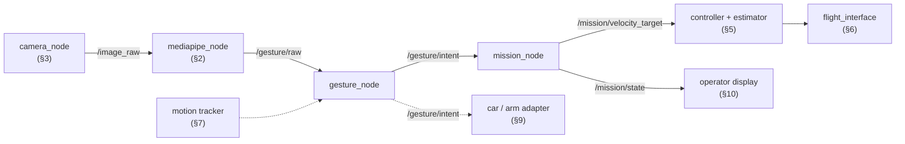
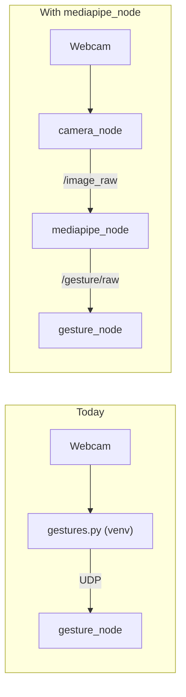

# 🔭 Future nodes to add

Nodes and packages that the gesture chain will need after `gesture_node` and `mission_node`, and some that would make it better. Each one says why we would add it, what it reads and publishes, and what must be decided first.

> [!WARNING] Status: ideas and proposals
> Nothing on this page is decided or built. Topic names and message types are **proposals**. A node that changes an accepted decision (for example the MediaPipe node vs [[ADR-018 Ground OS and ROS 2|ADR-018]]) needs a new ADR first. Turn an item into work with the Spike or Task issue form, not here.

---

## 🗺️ 1. Overview



| § | Node or package | Why | When (proposal) | Status |
| :---: | :--- | :--- | :--- | :---: |
| 2 | `mediapipe_node` | recogniser inside ROS 2 instead of UDP | after the chain works end to end | ==🟣idea, needs ADR== |
| 3 | `camera_node` | camera frames as a ROS topic | with §2 | ==🟣idea== |
| 4 | `drone_msgs` | typed messages instead of JSON strings | before `mission_node` is coded | ==🟠proposed== |
| 5 | controller + estimator | velocity target → attitude setpoints | Module 1, week 5 | ==🟠planned== |
| 6 | `flight_interface` | ground ↔ drone link, sim and real backends | Module 1 | ==🟠planned== |
| 7 | motion tracker | wave / swipe gestures | after vocabulary v0 is stable | ==🟣idea== |
| 8 | trained classifier | replace the rule-based `recognize()` | Module 2 | ==🟠accepted in roadmap== |
| 9 | car / arm adapter | portability proof | Module 2 | ==🟠accepted in roadmap== |
| 10 | operator display | show the mode and the reason to the operator | any time | ==🟣idea== |
| 11 | `gesture_bringup` | start everything with one launch file | as soon as there are 2 nodes | ==🟠proposed== |

---

## 🖐️ 2. `mediapipe_node`: MediaPipe inside ROS 2

Today `gestures.py` runs in its own venv and talks to `gesture_node` over UDP ([[00 Gesture Pipeline]] §5). A `mediapipe_node` would make the recogniser a real ROS 2 node.



### What it would do

| | Proposal |
| :--- | :--- |
| **Reads** | `/image_raw` (`sensor_msgs/msg/Image`) from `camera_node` (§3), converted to an RGB NumPy array with `cv_bridge` |
| **Does** | calls `create_hands()` and `detect_gesture()` from `hand_processing.py`, unchanged ([[01 Gesture Recognition with OpenCV and MediaPipe\|01]] §2: it accepts any RGB array) |
| **Publishes** | `/gesture/raw`: gesture name, palm `xy`, timestamp, every frame. Optional `/gesture/landmarks` (21 points) for logging and the classifier (§8) |
| **Then** | `gesture_node` subscribes to `/gesture/raw` instead of the UDP socket. `gesture_filter.py` is ROS-free, so the safety rules stay **exactly** the same |

### Pros and cons

| Pros | Cons |
| :--- | :--- |
| No UDP port and no second process to start by hand | MediaPipe's pip `numpy` / OpenCV can clash with the apt ROS packages (`cv_bridge`). This is the reason for [[ADR-018 Ground OS and ROS 2\|ADR-018]] |
| `ros2 bag` can record the images and landmarks, so recognition bugs can be replayed | Heavier node; a MediaPipe crash now happens inside the ROS graph |
| One launch file starts everything (§11) | Loses the clean "recogniser knows nothing about ROS" split |
| Standard tools (`rqt_image_view`, `ros2 topic hz`) on the camera feed | More work to package (pip dependency inside a colcon package) |

### Ways to solve the dependency clash (to compare in a spike)

1. **venv with system packages:** create the venv with `python3 -m venv --system-site-packages`, install `mediapipe` there, and run the node from that venv. ROS stays from apt, MediaPipe from pip. Check that `numpy` from pip does not break `cv_bridge`.
2. **Port to the Tasks API on MediaPipe 1.1.0:** needed anyway, because 0.10.21 is the last version with `mp.solutions` ([[00 Gesture Pipeline]] §6). 1.1.0 supports Python 3.12 and ARM64 (Raspberry Pi 5).
3. **Container:** run the node in a Docker image with ROS 2 Jazzy and MediaPipe pinned together.

### Before building it

- [ ] Spike issue: try options 1 to 3, record what works on Ubuntu 24.04 + Jazzy
- [ ] New ADR that amends or supersedes [[ADR-018 Ground OS and ROS 2|ADR-018]] (never edit it silently)
- [ ] Keep `gestures.py` + UDP working until the node passes the same tests ([[02 ROS 2 Nodes - Install and Test|02]] §9)

---

## 📷 3. `camera_node`: the webcam as a ROS topic

Needed by §2. No code to write: use an existing package.

| Option | Install | Publishes |
| :--- | :--- | :--- |
| `v4l2_camera` | `sudo apt install ros-jazzy-v4l2-camera` | `/image_raw`, `/camera_info` |
| `usb_cam` | `sudo apt install ros-jazzy-usb-cam` | `/image_raw`, `/camera_info` |

```bash
ros2 run v4l2_camera v4l2_camera_node --ros-args -p video_device:=/dev/video2
ros2 run rqt_image_view rqt_image_view     # check the picture
```

Mirroring: `gestures.py` flips the frame so left and right match the operator ([[01 Gesture Recognition with OpenCV and MediaPipe|01]] §2). With a camera node, `mediapipe_node` must flip the image itself.

---

## 📨 4. `drone_msgs`: typed messages

`/gesture/intent`, `/mission/state` and `/flight/state` are JSON inside `std_msgs/String` ([[04 Gesture_node]] §9, [[05 Mission_Node]] §10). A message package would make them typed and checked.

```text
drone/ground/src/drone_msgs/
├── package.xml          # ament_cmake + rosidl_default_generators
├── CMakeLists.txt
└── msg/
    ├── GestureIntent.msg    # string intent, string gesture, string reason, builtin_interfaces/Time stamp, float32[] xy
    ├── MissionState.msg
    └── FlightState.msg
```

- Interface packages must be **CMake** (`ament_cmake`), even if every node using them is Python.
- Changing a message changes a contract between tracks. Agree it in a PR reviewed by both tracks.

---

## 🎛️ 5. Velocity controller + estimator

Reads `/mission/velocity_target` and the estimator velocity (flow + IMU + baro), and outputs roll/pitch angles, yaw rate and throttle. Planned for Module 1 week 5 (tracks C + E, [[Study Plan v2]]). What it receives is in [[05 Mission_Node]] §6. Open question there: keep mission and controller as two nodes, or one.

---

## 📡 6. `flight_interface`: the link to the drone

A ROS 2 **lifecycle** node that packs setpoints into `SETPOINT` packets for the ESP8266 ([[Protocol Spec v0]]), with its own watchdog, and a PX4 SITL backend for simulation ([[ADR-019 Sim Backends|ADR-019]]). The folder `drone/ground/src/flight_interface/` exists but holds only `info.md`. It would also publish `/flight/state` for `mission_node` ([[05 Mission_Node]] §2.2).

---

## 👋 7. Motion tracker: wave and swipe

Static poses only cover "which fingers, which way". A tracker that follows the palm position over several frames could add movement gestures as **mode commands** (for example wave = land request), never as direct motion.

- Needs the palm `xy`, which `gestures.py` does not send yet ([[04 Gesture_node]] §3).
- Could live inside the recogniser, or as a small node between it and `gesture_node`.
- Any new gesture must go through the same stability filter and be added to the vocabulary ([[00 Gesture Pipeline]] §3).

---

## 🧠 8. Trained gesture classifier (Module 2)

Replace the rule-based `recognize()` with a classifier trained on the 21 landmarks: versioned dataset, reproducible training, model card, INT8 accuracy before/after, latency and power budget ([[Roadmap to April 2027]] §4). It keeps the same output names, so `gesture_node` does not change. Recording `/gesture/landmarks` (§2) with `ros2 bag` is an easy way to build the dataset.

---

## 🚗 9. Car / arm adapter (Module 2)

The portability proof: the same `/gesture/intent` drives a second hardware class. A small node maps intents to the car's `cmd_vel` (`geometry_msgs/Twist`) or to arm commands, with its own limits, the same way `mission_node` does for the drone ([[Roadmap to April 2027]] §4).

---

## 🖥️ 10. Operator display

Shows the operator what the system thinks: current mode, intent, `reason`, land request, `axis_not_owned`. It reads `/mission/state` and `/gesture/intent`. Start simple (`ros2 topic echo`, `rqt`), or draw an overlay in the camera window. Display only: it never sends commands.

---

## 🚀 11. `gesture_bringup`: one launch file

A package with a launch file and a parameter YAML that starts `gesture_node` and `mission_node` (later the camera and `mediapipe_node`) with agreed values:

```bash
ros2 launch gesture_bringup gestures.launch.py
```

The safety parameters ([[04 Gesture_node]] §7, [[05 Mission_Node]] §2.3) then live in one reviewed YAML file instead of command lines.

---

## Glossary

| Term | Meaning |
| --- | --- |
| **ADR** | Architecture Decision Record: a documented decision and its rationale. |
| **cv_bridge** | ROS package that converts between `sensor_msgs/Image` and OpenCV / NumPy images. |
| **Interface package** | A ROS 2 package that only defines messages, services or actions. |
| **Launch file** | A Python file that starts several nodes with their parameters (`ros2 launch`). |
| **Lifecycle node** | A ROS 2 node with managed states (configure, activate, deactivate), used for `flight_interface`. |
| **MediaPipe** | A Google framework used here to detect hand landmarks. |
| **Spike** | A short, time-boxed investigation to answer a question before building. |
| **Tasks API** | MediaPipe's newer API (`HandLandmarker`) that replaces the removed `mp.solutions`. |
| **v4l2** | Video4Linux2, the Linux camera interface (`/dev/video*`). |
