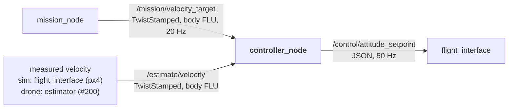

# 🎛️ Controller_Node: velocity target → attitude setpoint

`controller_node` sits between [[04 Mission Node|mission_node]] and [[05 Flight Interface Node|flight_interface]]. It turns the velocity `mission_node` wants ("0.3 m/s to the right") into the attitude that gets the drone there (roll, pitch, yaw rate, throttle), using the velocity the drone really has. It is the outer loop of a cascade: the inner loop, attitude → motors, stays in the flight controller (Betaflight on the drone, PX4 in the simulator).

> [!WARNING] Status: DRAFT
> - Flies only where a measured velocity exists. In the simulation (PX4 SITL) it does: `make sim-hold` holds 60 s, at most 0.19 m off (limit 0.25 m; REQ-NAV-001, [[PX4 SITL Setup]] §7.5). On the real drone there is none until the flow + height estimator (#200), so it stays inactive and nothing that reaches the drone changes.
> - The gains are the starting values; they were enough in SITL. The real drone gets its own tuning in the cage.
> - Its rules are accepted decisions: [[ADR-025 flight_interface Ground Node|ADR-025]] C1 and §2.4 (F1–F28).

---

## 📍 1. Where it sits, and why it exists



The gesture chain thinks in velocities; the flight controller holds an attitude. Something on the ground has to close the loop between them, and it must be the same code in the simulation and on the drone, so what passes in SITL is what flies. Only the source of the measured velocity changes (ADR-025 F1).

---

## 📦 2. The package

`drone/ground/src/controller/controller_node/`, image `rosrangers/controller:jazzy`:

| Piece | What it does |
| :--- | :--- |
| `controller_logic.py` | the control law and every rule of §5, no ROS imports |
| `controller_node.py` | the node: two subscriptions, one 50 Hz timer, parameters |
| `spin.py` | Ctrl+C / `docker stop` → one last inactive setpoint, exit 0; a bad parameter → FATAL, exit 1 |

---

## 📥 3. Input

- `/mission/velocity_target` (`TwistStamped`, body FLU, yaw rate in rad/s) from `mission_node`.
- `/estimate/velocity` (`TwistStamped`, body FLU): the measured velocity. In the simulation `flight_interface`'s `px4` backend publishes it from PX4; on the drone, the estimator of #200.
- Parameters (`controller_node.py`): `mask`, `hover_throttle`, `rate_hz`, the gains `kp_xy`, `ki_xy`, `kp_z`, `ki_z`, `tilt_cap_deg`, `throttle_band`, `target_timeout_sec`, `velocity_timeout_sec`, the topic names. A bad value stops the node at start-up. `mask` and `hover_throttle` must equal `flight_interface`'s: each mode file repeats them in both sections and `test_config.py` checks they agree.
- **Live tuning** (ADR-025 F28): the gains, `tilt_cap_deg`, `throttle_band` and the two timeouts can change while it runs, checked like at start-up; a bad value is refused and the old one kept, and the log says `retuned: …`. A batch is all or none. `hover_throttle` may only go to 0.0 (a pause: always inactive, so `flight_interface` sends neutral) and back to its start value (F28 note, 2026-11-26; `make sim-hold` uses it). `mask`, `rate_hz` and the topics need a restart. From `drone/ground/`, in the mode's domain ([[01 ROS2 Nodes Installation|01]] §5):

  ```bash
  docker compose --env-file env/sim.env run --rm echo ros2 param set /controller_node kp_xy 1.2
  ```

  A live change is lost on restart: write the value into `config/<mode>.yaml` to keep it.

---

## ⚙️ 4. Processing

One PI loop per axis on the velocity error (target − measured), every tick (50 Hz):

| Axis | Error → output |
| :--- | :--- |
| Forward / left | wanted acceleration → tilt: pitch for forward, roll for left (tilt = atan(a / g)) |
| Up | throttle around the hover throttle, divided by cos(roll)·cos(pitch) while tilted |
| Yaw | the target yaw rate, passed through |

The worked examples are in the comments of `controller_logic.py`. The integrators stop while the output is at its limit (anti-windup) and are cleared whenever the output goes inactive. Axes outside the mask get level attitude and the hover throttle.

---

## 🛡️ 5. Rules

| Rule | In short |
| :--- | :--- |
| Input clamp | the target is clamped first: 0.5 m/s horizontal (as a vector, direction kept), 0.5 m/s vertical, 45 °/s yaw; a non-finite value counts as 0 |
| Stale target | not fresh at the next tick (older than 0.25 s then) → a zero target: the drone holds zero velocity, at most 0.25 s after the last target (REQ-SAF-017, F11 note 2026-11-26) |
| Active | only while a measured velocity arrived in the last 0.25 s and the hover throttle is measured (not 0.0). A zero target with a fresh measurement is active: "hold zero velocity", also while `mission_node` is not `ENGAGED` |
| Limits | roll / pitch ≤ 15°, throttle within hover ± 0.15. `flight_interface`'s guard checks the same limits again |
| Inactive | `active` false with the `reason`: neutral, whatever the numbers |

Every rule with its reason: [[ADR-025 flight_interface Ground Node|ADR-025]] C1, F4, F8–F11, F14, F16.

---

## 📤 6. Output

- `/control/attitude_setpoint`: JSON on `std_msgs/String`, 50 Hz, active or not:

  ```json
  {"roll": -3.0, "pitch": 1.5, "yaw_rate": 0.0, "throttle": 0.74, "active": true, "reason": "ok"}
  ```

  `roll`, `pitch` in degrees, `yaw_rate` in °/s, `throttle` 0–1, body FLU with REP-103 signs (as `/fc/attitude`): roll + = right side down, pitch + = nose down, yaw rate + = turn left.
- `reason`: `ok`, `no_velocity`, `stale_velocity`, `no_hover_throttle`, or `stopped` (the last setpoint on the way out).
- The live table's CONTROL row shows `active` and `reason`, and the numbers while active ([[01 ROS2 Nodes Installation|01]] §4.6).
- Logs in `logs/controller/latest.log`: every change of `reason`, and every 5 s how many targets and measured velocities arrived.

---

## ▶️ 7. Run (Docker)

The `controller` compose service runs in the real and sim modes, with the mode's file `config/<mode>.yaml`. The demo runs none (ADR-025 F12): with no measured velocity and no `flight_interface` it could only publish inactive setpoints.

| Mode | Measured velocity | Hover throttle | What it does |
| :--- | :--- | :--- | :--- |
| real (`make real`) | none until #200 | not set | inactive: `flight_interface` sends neutral |
| sim (`make sim`, `sim-smoke`, `sim-hold`) | from PX4 | 0.73 | flies ([[PX4 SITL Setup]] §7) |

---

## 🧪 8. Test

`controller_logic.py` is tested without ROS (`test_controller_logic.py`: each axis' sign, saturation, anti-windup, the input clamp, staleness, the active rules, the masks). The node is tested with ROS (`test_controller_node_ros.py`, `test_controller_node_process.py`: the topics, the last setpoint on stop, a bad parameter). `test_ceilings_match.py` checks the velocity ceilings against `mission_node`'s. CI runs them in `ground-ros2` with its 90 % coverage gate; `make smoke` runs them inside the image. End to end: `make sim-smoke` and `make sim-hold` ([[PX4 SITL Setup]] §7.4, §7.5).

---

## 🧭 9. Design decisions

| Decision | Why |
| :--- | :--- |
| Its own node, not inside `flight_interface` | Control law and the link / safety node stay apart (C1.1, C1.5) |
| Gains changeable live, mask not, hover throttle only to 0.0 and back | Tuning in the cage without restarts; the mask and hover throttle must equal `flight_interface`'s (F15, F28) |
| The measured velocity from a neutral topic | The controller never imports PX4 messages: the same code flies the simulation and the drone (F1) |
| A velocity loop only, no position loop | Simplest; SITL showed it holds within REQ-NAV-001. A position loop comes only if a hold fails on drift (F7) |
| Gains tuned in the simulation stay in `config/sim.yaml` | The real drone starts from the code defaults and is tuned on its own (F27) |

---

## 🔖 10. Requirement IDs

| ID | Requirement | Checked in |
|---|---|---|
| REQ-NAV-001 | Position hold in SITL: 0.25 m horizontal, ±0.15 m vertical, 60 s. | `make sim-hold` |
| REQ-SAF-017 | Zero within 0.25 s of losing the target. | `test_controller_logic.py`, `make sim-smoke` |
| REQ-SAF-018 | No command on an axis outside the mask. | `test_controller_logic.py`, `make sim-smoke` |

---

## ❓ 11. Open points

- [ ] **A measured velocity on the drone** (#200, flow + height): until then the controller is inactive on the real drone.
- [ ] **Gains for the real drone**, tuned in the cage (REQ-NAV-002).
- [ ] **Yaw-only pass-through on the drone** (mask 8) once the bench allows it (ADR-025 F6).

---

## 🔗 12. Related pages

[[00 Gesture Pipeline]] · [[04 Mission Node]] · [[05 Flight Interface Node]] · [[06 Final Connections and Missing Parts]] · [[PX4 SITL Setup]] · [[ADR-025 flight_interface Ground Node|ADR-025]] · [[Safety Rules]]

---

## Glossary

| Term | Meaning |
| --- | --- |
| **Cascade controller** | Two loops in a row: the ground's velocity loop sets the attitude, the flight controller's attitude loop sets the motors. |
| **PI loop** | Proportional + integral control: reacts to the error now (P) and to the error built up over time (I). |
| **Gain** | A multiplier in the loop: how strongly it reacts (`kp_*` to the error now, `ki_*` to the error built up). |
| **Anti-windup** | The integrator stops growing while the output is already at its limit. |
| **Attitude setpoint** | Roll, pitch, yaw rate and throttle that the drone should hold. |
| **Hover throttle** | The throttle (0–1) that holds the drone level in the air; 0.0 means not measured. |
| **Measured velocity** | The velocity the drone really has, from an estimator (PX4 in SITL, #200 on the drone). |
| **FLU** | Body frame with x forward, y left, z up (REP-103). |
| **REP-103** | The ROS convention for units and frame directions. |
| **Mask** | `msp_override_channels_mask`: which axes the ground commands (8 yaw, 11 roll + pitch + yaw, 15 all four). |
| **SITL** | Software In The Loop: the flight code runs on the PC against a simulator. |
| **ADR** | Architecture Decision Record: a documented decision and its rationale. |
| **Estimator** | Code that computes the drone's velocity from sensors (flow, IMU, barometer); on the drone it is #200. |
| **FC** | Flight Controller: on this project the OddityRC F7 AIO (STM32F722, Betaflight target `ODDITYRCF7AIO`) of the 2.5" drone. It stabilises the aircraft and takes MSP from the ESP on UART4. |
| **Neutral / inactive** | `active` false: no command; the numbers are level and the hover throttle, and nothing may use them. |
| **PX4** | An open-source flight-control stack, used here only in simulation (PX4 SITL + Gazebo). |
| **px4 backend** | Sim-only backend of `flight_interface`: attitude setpoints (or, when nothing commands, PX4's own hold of a frozen position) → PX4, PX4 state → `/flight/state`, PX4 velocity → `/estimate/velocity`. |
| **REQ ID** | A requirement identifier, `REQ-<area>-NNN`, registered in [[Requirements]]. |
| **Velocity target** | The velocity `mission_node` wants, on `/mission/velocity_target` (body FLU, 20 Hz). |
