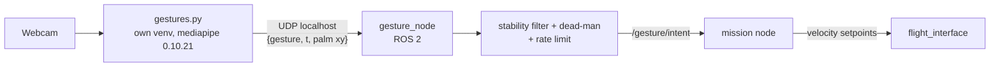

# Gesture Pipeline (integration with the drone)

> [!info] Builds on [[Gesture Recognition Program]]
> That note documents the working webcam prototype (`gestures.py`, rule-based static gestures). This page describes how it connects to the drone **safely**. Decision: [[ADR-015 Gesture Input Source|ADR-015]] (ground webcam).

---

## 1. MediaPipe version notes (verified 2026-10-12)

Keep **`mediapipe==0.10.21`** (legacy `mp.solutions.hands`, works on Ubuntu 24.04 / Python 3.12). MediaPipe 1.1.0 removed `mp.solutions`, so upgrading needs a port to the Tasks API. Details: [[Gesture Recognition Program]] (update note at the top).

## 2. Architecture

- `execute()` in `gestures.py` stops printing and sends one small JSON datagram per **change** (plus a 5 Hz keep-alive) to `127.0.0.1`.
- MediaPipe stays out of the ROS 2 Python environment ([[ADR-018 Ground OS and ROS 2|ADR-018]]).

## 3. Vocabulary v0 (names produced by `recognize()`)

| Gesture name | Intent | Notes |
|---|---|---|
| `OPEN_HAND_UP` (held) | **enable / hold position** | dead-man: control only while it is visible |
| `CLOSED_HAND` | stop, hover in place | |
| `THUMB_UP` | climb slowly | only once throttle is ours (mask 15) |
| `THUMB_DOWN` | descend slowly / land request | |
| `INDEX_LEFT` / `INDEX_RIGHT` | move left / right | the frame is mirrored, so this is the **operator's** left/right |
| `INDEX_MIDDLE_LEFT` / `INDEX_MIDDLE_RIGHT` | yaw left / right | |
| none / unknown | **neutral** | never "continue the last command" |

Movement gestures (wave, swipe) from the planned `MotionTracker` can be added later as mode commands (e.g. wave = land request).

## 4. Safety logic (in `gesture_node` / mission, not in `gestures.py`)

- Stability filter, no-hand timeouts and the hover/land fallback: the rules and parameters are in [[Ros Jazzy and Gesture_node]] §6.3–6.4 (single source for the values).
- Hard velocity limits (e.g. 0.3 m/s) in the mission node.
- Gestures can never arm, disarm the drone or change the override switch (SAF-03/04).

## 5. Module 2 extension (accepted by instructors)

Replacing the rule-based `recognize()` with a trained landmark classifier, and the portability proof (same `/gesture/intent` driving the car or the arm), are planned in [[Roadmap to April 2027]] §4.

## 6. Glossary

| Term | Meaning |
| --- | --- |
| **ADR** | Architecture Decision Record: a documented decision and its rationale. |
| **API** | Application Programming Interface: a defined way for software components to communicate. |
| **MediaPipe** | A framework used here for detecting and interpreting hand landmarks and gestures. |
| **Mermaid** | A text-based diagram syntax rendered by compatible Markdown tools. |
| **ROS 2** | The second-generation Robot Operating System middleware used for robotics integration. |
| **UDP** | User Datagram Protocol: connectionless transport suited to refreshed, time-sensitive data. |
