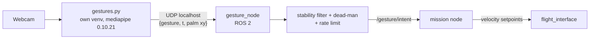

# Gesture Pipeline (integration with the drone)

> [!info] Builds on [[Gesture Recognition Program]]
> That note documents the working webcam prototype (`gestures.py`, rule-based static gestures). This page describes how it connects to the drone **safely**. Decision: [[ADR-015 Gesture Input Source|ADR-015]] (ground webcam).

---

## 1. MediaPipe version notes (verified 2026-10-12)

Keep **`mediapipe==0.10.21`** (legacy `mp.solutions.hands`, works on Ubuntu 24.04 / Python 3.12). MediaPipe 1.1.0 removed `mp.solutions`, so upgrading needs a port to the Tasks API. Details: [[Gesture Recognition Program]] (update note at the top).

## 2. Architecture



- `execute()` in `gestures.py` stops printing and sends one small JSON datagram per **change** (plus a 5 Hz keep-alive) to `127.0.0.1`.
- MediaPipe stays out of the ROS 2 Python environment ([[ADR-018 Ground OS and ROS 2|ADR-018]]).

## 3. Vocabulary v0 (names produced by `recognize()`)

| Gesture name | Intent | Notes |
|---|---|---|
| `OPEN_HAND_UP` (held) | **enable / hold position** | dead-man: control only while it is visible |
| `CLOSED_HAND` | stop, hover in place | |
| `THUMB_UP` | climb slowly | only once throttle is ours (mask 15) |
| `THUMB_DOWN` | descend slowly / land request | |
| `INDEX_LEFT` / `INDEX_RIGHT` | move left / right | the frame is mirrored, so this is the **operator's** left/right |
| `INDEX_MIDDLE_LEFT` / `INDEX_MIDDLE_RIGHT` | yaw left / right | |
| none / unknown | **neutral** | never "continue the last command" |

Movement gestures (wave, swipe) from the planned `MotionTracker` can be added later as mode commands (e.g. wave = land request).

## 4. Safety logic (in `gesture_node` / mission, not in `gestures.py`)

- Stability filter, no-hand timeouts and the hover/land fallback: the rules and parameters are in [[Ros Jazzy and Gesture_node]] §6.3–6.4 (single source for the values).
- Hard velocity limits (e.g. 0.3 m/s) in the mission node.
- Gestures can never arm, disarm the drone or change the override switch (SAF-03/04).

## 5. Where the files live

| File or folder | Repo path | Runs in |
|---|---|---|
| `gestures.py`, `hand_processing.py`, `gesture_sender.py`, `requirements.txt` | `drone/tools/gesture/` | Own venv `drone/tools/gesture/.venv` (MediaPipe, OpenCV). Not part of ROS 2. |
| `gesture_node` (ROS 2 package: `package.xml`, `setup.py`, `setup.cfg`, `resource/`, `gesture_node/`, `test/`) | `drone/ground/src/gesture_node/` | System Python with ROS 2 Jazzy |
| `~/ros2_ws/` (`build/`, `install/`, `log/`) | **Host PC, outside the repo** | Build output of colcon |

- `package.xml` must sit directly inside `drone/ground/src/gesture_node/`, and the Python module folder `gesture_node/gesture_node/` holds only `__init__.py`, `gesture_filter.py` and `gesture_node.py`.
- `gesture_sender.py` is imported by `gestures.py`, so the two must stay in the same folder.

### Why `ros2_ws` stays on the host and not in the repo

- A ROS 2 workspace is a **build folder**. `colcon build` writes `build/`, `install/` and `log/` into it. These are generated, large and specific to one machine and one ROS version, so they must never be committed.
- The **source** is in the repo. The workspace only links to it: `~/ros2_ws/src/gesture_node` is a symlink to `drone/ground/src/gesture_node`. With `--symlink-install`, editing a file in the repo takes effect without rebuilding.
- Every teammate (and the CI runner) creates their own workspace from the same repo, so results do not depend on what is left in someone's build folder.
- If you want the workspace inside the project anyway, point colcon at the repo (`colcon build --base-paths drone/ground/src`) and add `build/`, `install/` and `log/` to `.gitignore`.

## 6. Run the pipeline

Use three terminals and start the node first. The two ROS terminals use the **system** Python, so do not activate the venv there. The recogniser terminal uses the venv, so do not source ROS there.

### 6.1 One-time setup

```bash
sudo apt install python3-venv libgl1 libglib2.0-0 v4l-utils libxcb-cursor0 \
                 python3-colcon-common-extensions ros-jazzy-ros-base
python3 --version   # MediaPipe 0.10.21 needs 3.10 to 3.12 (Ubuntu 24.04 gives 3.12)
```

Create and build the workspace:

```bash
source /opt/ros/jazzy/setup.bash
mkdir -p ~/ros2_ws/src
ln -s ~/ROSRangers/drone/ground/src/gesture_node ~/ros2_ws/src/gesture_node
cd ~/ros2_ws
colcon build --packages-select gesture_node --symlink-install
colcon test --packages-select gesture_node && colcon test-result --verbose
```

- `source /opt/ros/jazzy/setup.bash` loads ROS 2 itself (`colcon`, `ros2`, `rclpy`). It is needed in every terminal that builds or runs ROS 2.
- `colcon build` creates `build/`, `install/` and `log/` in `~/ros2_ws`.
- Rebuild only after changing `setup.py` or `package.xml`. Python edits do not need it.

### 6.2 The three terminals

**Terminal 1: the node**

```bash
source /opt/ros/jazzy/setup.bash
source ~/ros2_ws/install/setup.bash
ros2 run gesture_node gesture_node
```

- `source ~/ros2_ws/install/setup.bash` makes ROS 2 find `gesture_node`. It must come after the `/opt/ros` line, and must be repeated in every new terminal and after every rebuild.
- Expected: `Listening for gestures.py on UDP 127.0.0.1:5005`. Until the recogniser starts it warns `No packets from gestures.py` every 5 s.

**Terminal 2: watch the topic**

```bash
source /opt/ros/jazzy/setup.bash
source ~/ros2_ws/install/setup.bash
ros2 topic echo /gesture/intent
```

**Terminal 3: the recogniser (camera window)**

```bash
cd ~/ROSRangers/drone/tools/gesture
python3 -m venv .venv                 # first time only
source .venv/bin/activate
pip install -r requirements.txt       # first time only
python3 -c "import cv2, mediapipe; print(cv2.__version__, mediapipe.__version__)"
python3 gestures.py                   # on Wayland: QT_QPA_PLATFORM=xcb python3 gestures.py
```

Press `q` in the window to quit.

### 6.3 What to expect

| Check | What you should see |
|---|---|
| MediaPipe runs | The `python3 -c` line prints two versions without errors. |
| Window opens | A window titled `Gestures` shows the webcam. If it is black or does not open, change `VideoCapture(0)` in `gestures.py` to `1` or `2` and check `ls /dev/video*`. |
| Hand tracking | Landmarks are drawn on your hand and the gesture name is printed in terminal 3 when it changes. |
| Link works | Terminal 1 logs `First packet from gestures.py`, then `Recogniser link OK` every 5 s. |
| Node publishes | After about 0.4 s of a stable gesture, terminal 1 logs `Intent -> ...` and terminal 2 shows it. The topic runs at about 20 Hz (`ros2 topic hz /gesture/intent`). |
| Safety fallback | Hand out of view for a moment gives `NEUTRAL`. Out of view for a few seconds, or closing the window, gives `HOVER_LAND_REQUEST`. |

The detailed levels of proof are in [[Ros Jazzy and Gesture_node]] §10, and the rules and parameters in §6.3–6.4 of that note.

## 7. Test without the camera

This checks the ROS 2 side (UDP receive, filter, `/gesture/intent`) with no webcam and no MediaPipe. `gesture_sender.py` uses only the standard library, so it runs on the system Python and no venv is needed.

1. Terminal 1 and terminal 2 exactly as in §6.2.
2. In a third terminal, run the fake camera:

```bash
cd ~/ROSRangers/drone/tools/gesture
python3 gesture_sender.py
```

It plays a scripted sequence of about 13 s and prints what it is sending. Terminal 2 should show these intents (full table with timings: [[Ros Jazzy and Gesture_node]] §10, Level 0):

| Fake input | Expected intent |
|---|---|
| nothing yet | `HOVER_LAND_REQUEST` / `no_packets_yet` |
| `OPEN_HAND_UP` | `NEUTRAL`, then `HOLD_POSITION` after about 0.4 s |
| `INDEX_RIGHT` | `MOVE_RIGHT` |
| short gap (0.6 s) | `NEUTRAL` / `no_hand` |
| `CLOSED_HAND` | `STOP_HOVER` |
| long gap (3 s) | `HOVER_LAND_REQUEST` / `no_hand_long` |
| `INDEX_LEFT` | `MOVE_LEFT` |
| sender stops | `NEUTRAL`, then `HOVER_LAND_REQUEST` / `no_packets` |

The unit tests for the filter alone (no ROS 2 running) are in §6.1 (`colcon test`).

## 8. Module 2 extension (accepted by instructors)

Replacing the rule-based `recognize()` with a trained landmark classifier, and the portability proof (same `/gesture/intent` driving the car or the arm), are planned in [[Roadmap to April 2027]] §4.

## 9. Glossary

| Term | Meaning |
| --- | --- |
| **ADR** | Architecture Decision Record: a documented decision and its rationale. |
| **API** | Application Programming Interface: a defined way for software components to communicate. |
| **MediaPipe** | A framework used here for detecting and interpreting hand landmarks and gestures. |
| **Mermaid** | A text-based diagram syntax rendered by compatible Markdown tools. |
| **ROS 2** | The second-generation Robot Operating System middleware used for robotics integration. |
| **UDP** | User Datagram Protocol: connectionless transport suited to refreshed, time-sensitive data. |
