---

title: ROS 2 and Gesture Node
type: guide
status:
draft date: 2026-10-14
project: SEA autonomous drone
tags:

- gestures
- ros2
- guide

---

# ROS 2 and Gesture Node

> [!info] Where this fits [[Gesture Pipeline]] is the architecture. This page is the practical guide: what ROS 2 is, how to install it, how to install `gesture_node` (v0.2), and how to **prove** that `gestures.py` is being processed. The recogniser itself is in [[Gesture Recognition Program]].

> [!warning] Status: DRAFT: tested on the host with ROS 2 stubbed, not yet built on real Jazzy The filter logic has 17 unit tests, and a run of the real `gesture_sender.py` into the real node code behaved as described in §8. Nobody has run `colcon build` on a real Jazzy install yet. Record the first real build in §12.

---

## 1. What ROS is

**ROS** (Robot Operating System) is not an operating system. It is a framework and a set of tools for building a robot program out of many small programs that talk to each other in a standard way. **ROS 2** is the current generation (a rewrite of the original ROS). It runs on Linux (and others) and provides:

- the way programs find and talk to each other (**topics**, services, actions),
- tools to build, run, inspect and record them (`colcon`, `ros2 topic echo`, `ros2 bag`),
- ready-made messages and libraries (`std_msgs`, `geometry_msgs`, `rclpy`).

|Word|Meaning|In this project|
|---|---|---|
|**Node**|one running program with one job|`gesture_node`, mission node, `flight_interface`|
|**Topic**|a named channel that carries messages|`/gesture/intent`|
|**Message**|a typed piece of data on a topic|`std_msgs/msg/String`|
|**Publisher**|a node that sends to a topic|`gesture_node`|
|**Subscriber**|a node that receives from a topic|mission node|
|**Package**|a folder of code that builds into nodes|`gesture_node`|
|**Workspace**|the folder where packages are built|`~/ros2_ws`|

## 2. What ROS 2 Jazzy is, and why we use it

ROS 2 comes in **distributions**, each tied to a Ubuntu version. **Jazzy Jalisco** ("Jazzy") was released in May 2024.

|Item|Value|
|---|---|
|Release type|LTS (long-term support), supported until May 2029|
|Supported OS|**Ubuntu 24.04 (Noble)**, x86-64 and ARM64|
|Python|3.12 (the Ubuntu 24.04 system Python)|

We use it because the plan and [[ADR-018 Ground OS and ROS 2|ADR-018]] choose Ubuntu 24.04 + Jazzy ([[Study Plan v2]], Track C). General reasons that support the choice: it is the LTS release that matches Ubuntu 24.04, it installs from ready-made `apt` packages, and the same packages cover the Raspberry Pi 5 option in [[Hardware Inventory]].

> [!danger] Jazzy needs Ubuntu 24.04 There are no Jazzy `apt` packages for Ubuntu 22.04 (that one is for Humble). Run `lsb_release -a` first. If it says 22.04 (system Python 3.10), upgrade or dual-boot to 24.04, use a container, or ask the team. Do not mix Humble instructions into this page.

## 3. Why several ROS 2 nodes instead of one big script

|One big script|Several nodes|
|---|---|
|A bug or freeze anywhere stops everything, including the safety checks|A crash stays inside one node. Neighbours notice it went silent (the dead-man timeouts)|
|MediaPipe, ROS and flight code share one Python environment and its version conflicts|MediaPipe 0.10.21 stays in its own venv ([[Gesture Pipeline]] §1). UDP on localhost joins the two worlds|
|Hard to test one part alone|Each node is started, tested and replaced alone: fake the input, read the output|
|Hard to reuse|The same `/gesture/intent` could drive the simulator, the drone, a car or an arm|
|Hard to see what happened|`ros2 topic echo` shows live data, `ros2 bag` records it for replay|
|Several people editing one file|Five tracks work on separate nodes with agreed message contracts|

The cost is some structure: messages have to be defined and the nodes have to be started together. For a flight system with a safety story, that trade is worth it. The Module 1 plan also expects a ROS 2 node graph.

## 4. How everything connects

```mermaid
flowchart LR
  W[Webcam] --> R["gestures.py<br/>own venv, mediapipe 0.10.21<br/>+ gesture_sender.py"]
  R -->|"UDP 127.0.0.1:5005<br/>JSON datagrams"| G["gesture_node<br/>(this package)"]
  G -->|"/gesture/intent<br/>std_msgs/String (JSON)"| M["mission node<br/>(planned)"]
  M -->|"velocity setpoints<br/>(topic and type to be decided)"| C["controller + estimator<br/>(planned)"]
  C -->|setpoints| FI["flight_interface<br/>(planned, lifecycle node)"]
  FI <-->|"UDP / TCP over Wi-Fi<br/>Protocol Spec v0"| E[ESP8266]
  E <-->|"MSP over UART4"| FC[Betaflight FC]
```



Only the first two arrows exist today. Everything to the right of `/gesture/intent` is planned ([[System Overview]], [[Protocol Spec v0]]).

|Piece|Runs in|Receives|Outputs|Status|
|---|---|---|---|---|
|`gestures.py` + `gesture_sender.py`|MediaPipe venv|webcam frames|UDP JSON on `127.0.0.1:5005`|prototype exists; sender is new|
|**`gesture_node`**|ROS 2|that UDP JSON|`/gesture/intent`|**this page**|
|mission node|ROS 2|`/gesture/intent`|velocity target|planned|
|controller, estimator|ROS 2|target, flow/IMU data|attitude/stick setpoints|planned|
|`flight_interface`|ROS 2|setpoints|`SETPOINT` packets (UDP)|planned|

## 5. What `gesture_node` does

1. **Receives** UDP datagrams from `gestures.py` (§6.1). A timer drains the socket 100 times a second. There are no threads.
2. **Filters** them with the safety rules of §6.3 (design in [[Gesture Pipeline]] §4).
3. **Publishes** the result on `/gesture/intent` at 20 Hz, a steady heartbeat even when nothing changes, so the next node can detect silence.
4. **Logs** the first packet, every intent change and a link report every 5 s. This is how you prove it works (§10).

The decision logic lives in `gesture_filter.py` with no ROS imports, so it can be unit-tested anywhere.

## 6. Inputs and outputs

### 6.1 Input: UDP JSON from `gestures.py`

Sent to `127.0.0.1:5005`. One datagram when the gesture **changes**, then a repeat every 0.1 s while it stays the same (the keep-alive; `gesture_sender.py` does this for you).

```json
{"gesture":"INDEX_RIGHT","t":1791976551.56,"xy":[0.51,0.42]}
```

No hand or nothing recognised:

```json
{"gesture":null,"t":1791976551.9,"xy":null}
```

|Field|Meaning|
|---|---|
|`gesture`|name from `recognize()`, or `null`. Case and spaces are ignored. `""`, `NONE`, `NO_HAND`, `UNKNOWN`, `NEUTRAL` count as no hand|
|`t`|sender time in seconds (information only; freshness uses the node's own clock)|
|`xy`|optional palm position `[x, y]`, or `null`|

Anything that is not a JSON object is ignored and counted. NaN or infinite numbers in `t` / `xy` are dropped to `null`.

### 6.2 Output: `/gesture/intent`

Type `std_msgs/msg/String`. `data` holds one JSON object:

```json
{"intent":"MOVE_RIGHT","gesture":"INDEX_RIGHT","reason":"ok","t":1791976551.56,"xy":[0.51,0.42]}
```

|Field|Meaning|
|---|---|
|`intent`|what the operator wants (table below)|
|`gesture`|the accepted gesture, or `null`|
|`reason`|why this intent: `ok`, `unconfirmed`, `no_hand`, `no_hand_long`, `no_packets`, `no_packets_yet`, `unmapped_gesture`|
|`t`, `xy`|from the latest packet, or `null`|

Receivers parse the JSON. A typed custom message would be cleaner and is a question for the architecture document.

### 6.3 Rules and the gesture → intent table

|Gesture|`intent`|
|---|---|
|`OPEN_HAND_UP`|`HOLD_POSITION`|
|`CLOSED_HAND`|`STOP_HOVER`|
|`THUMB_UP`|`CLIMB_SLOWLY`|
|`THUMB_DOWN`|`DESCEND_SLOWLY_LAND_REQUEST`|
|`INDEX_LEFT` / `INDEX_RIGHT`|`MOVE_LEFT` / `MOVE_RIGHT`|
|`INDEX_MIDDLE_LEFT` / `INDEX_MIDDLE_RIGHT`|`YAW_LEFT` / `YAW_RIGHT`|
|any other name|`NEUTRAL` (`unmapped_gesture`)|

What each gesture means and its conditions (for example, climb only once throttle is ours) are in [[Gesture Pipeline]] §3.

|Situation|Intent|`reason`|
|---|---|---|
|nothing received since the node started|`HOVER_LAND_REQUEST`|`no_packets_yet`|
|a new gesture seen in fewer than 5 consecutive packets|`NEUTRAL`|`unconfirmed`|
|a gesture seen in 5 consecutive packets|its intent|`ok`|
|hand gone for more than 0.3 s|`NEUTRAL`|`no_hand`|
|hand gone for more than 2 s|`HOVER_LAND_REQUEST`|`no_hand_long`|
|no packets at all for more than 2 s|`HOVER_LAND_REQUEST`|`no_packets`|

Three details that matter:

- A **short dropout** (under 0.3 s) keeps the current gesture, so one lost camera frame does not interrupt a movement.
- After a gap longer than 0.3 s, the old gesture is **forgotten**. It is never replayed when the hand comes back (this was a bug in v0.1).
- While you switch from one gesture to another, the old intent stays until the new gesture has 5 consecutive packets (about 0.4 s at the 10 Hz keep-alive).

The node only filters and relays intent. It never arms or disarms and never touches the override switch ([[Safety Rules]], rule 5). The mission node still has to treat `HOVER_LAND_REQUEST` at start-up as "no recogniser yet".

### 6.4 Parameters

```bash
ros2 run gesture_node gesture_node --ros-args -p udp_port:=5006 -p stable_packets:=3
```

|Parameter|Default|Meaning|
|---|---|---|
|`udp_host`|`127.0.0.1`|address to listen on|
|`udp_port`|`5005`|UDP port (must match `PORT` in `gesture_sender.py`)|
|`intent_topic`|`/gesture/intent`|topic to publish on|
|`stable_packets`|`5`|consecutive identical packets to accept a gesture|
|`neutral_timeout_sec`|`0.3`|hand gone this long → `NEUTRAL`|
|`stale_timeout_sec`|`2.0`|hand or packets gone this long → `HOVER_LAND_REQUEST`|
|`publish_rate_hz`|`20.0`|publish rate|

`stable_packets` and the two timeouts are safety settings. Agree changes with the team.

## 7. Install ROS 2 Jazzy

Source: the official _Ubuntu (deb packages)_ page of the Jazzy docs (checked 2026-10-14). If a command fails, compare with that page.

### 7.1 Check the system

```bash
lsb_release -a        # must say 24.04 (Noble)
locale                # must show UTF-8
```

If the locale is not UTF-8:

```bash
sudo apt update && sudo apt install locales
sudo locale-gen en_US en_US.UTF-8
sudo update-locale LC_ALL=en_US.UTF-8 LANG=en_US.UTF-8
export LANG=en_US.UTF-8
```

### 7.2 Add the ROS 2 repository

```bash
sudo apt install software-properties-common
sudo add-apt-repository universe

sudo apt update && sudo apt install curl -y
export ROS_APT_SOURCE_VERSION=$(curl -s https://api.github.com/repos/ros-infrastructure/ros-apt-source/releases/latest | grep -F "tag_name" | awk -F\" '{print $4}')
curl -L -o /tmp/ros2-apt-source.deb "https://github.com/ros-infrastructure/ros-apt-source/releases/download/${ROS_APT_SOURCE_VERSION}/ros2-apt-source_${ROS_APT_SOURCE_VERSION}.$(. /etc/os-release && echo ${UBUNTU_CODENAME:-${VERSION_CODENAME}})_all.deb"
sudo dpkg -i /tmp/ros2-apt-source.deb
```

### 7.3 Install ROS 2 and the build tools

```bash
sudo apt update && sudo apt upgrade
sudo apt install ros-jazzy-desktop     # ROS, RViz, demos, tutorials (recommended)
sudo apt install ros-dev-tools         # colcon, rosdep and other build tools
```

`ros-jazzy-ros-base` is the smaller install (no GUI tools). It is enough to run `gesture_node`.

### 7.4 Load the environment

Every terminal must load ROS 2 before any `ros2` command works:

```bash
source /opt/ros/jazzy/setup.zsh
```

To do it automatically in new terminals:

```bash
echo "source /opt/ros/jazzy/setup.zsh" >> ~/.zshrc
```

### 7.5 Initialise rosdep (once)

```bash
sudo rosdep init
rosdep update
```

### 7.6 Prove the install works

Terminal 1: `ros2 run demo_nodes_cpp talker`. Terminal 2: `ros2 run demo_nodes_py listener`. The listener prints the talker's messages: one node publishing to a topic, another receiving it.

### 7.7 Keep your lab neighbours out of your topics

ROS 2 nodes on the same network find each other automatically, so a teammate's node could appear on your topics. In every terminal (or `~/.bashrc`):

```bash
export ROS_DOMAIN_ID=42                         # your own number, 0-101, different from teammates
export ROS_AUTOMATIC_DISCOVERY_RANGE=LOCALHOST  # Jazzy: only talk to this machine
```

## 8. Install `gesture_node` and the sender

The package was first delivered as `gesture_node_ros2_package_v2.zip`. In the repo it is split in two places:

| File or folder | Repo path | Notes |
|---|---|---|
| `package.xml`, `setup.py`, `setup.cfg`, `resource/gesture_node`, `gesture_node/` (`__init__.py`, `gesture_filter.py`, `gesture_node.py`), `test/test_gesture_filter.py` | `drone/ground/src/gesture_node/` | The ROS 2 package. `package.xml` must be directly in this folder. |
| `gesture_sender.py` | `drone/tools/gesture/` | Plain Python for the MediaPipe side, next to `gestures.py`. |
| `udp_listen.py` (proof tool without ROS) | not in the repo yet | Optional. If you add it, put it in `drone/tools/gesture/`. |
| `~/ros2_ws/` | Host PC, **not in the repo** | Build folder, see below. |

> [!info] Why `ros2_ws` is on the host PC and not in the repo
> The workspace is only colcon's build output (`build/`, `install/`, `log/`). It is generated, large and tied to one machine and ROS version, so it is never committed. The source stays in the repo and the workspace links to it with a symlink, so editing the repo files is enough (`--symlink-install`). Each teammate and the CI runner builds their own workspace from the same repo. Step by step: [[Gesture Pipeline]] §5–6.

### 8.1 Build the node

```bash
mkdir -p ~/ros2_ws/src
ln -s ~/ROSRangers/drone/ground/src/gesture_node ~/ros2_ws/src/gesture_node   # symlink to the repo, not a copy

source /opt/ros/jazzy/setup.zsh
cd ~/ros2_ws
rosdep install --from-paths src --ignore-src -r -y
colcon build --packages-select gesture_node --symlink-install
source install/setup.zsh
```

- `~/ros2_ws/src/gesture_node/package.xml` must exist (through the symlink), not one folder deeper.
- `--symlink-install` lets you edit `gesture_node.py` in the repo and rerun without rebuilding.
- Run `source ~/ros2_ws/install/setup.bash` in **every new terminal** (or add it to `~/.bashrc` after the ROS line).
- Setuptools deprecation warnings during the build are common and harmless if it finishes with `Summary: 1 package finished`.
- **Do not activate the MediaPipe venv** in terminals that run ROS 2.

Check it is installed:

```bash
ros2 pkg list | grep gesture_node
```

### 8.2 Run the unit tests (optional, no ROS needed)

```bash
cd ~/ROSRangers/drone/ground/src/gesture_node
python3 -m unittest discover -s test -v      # 17 tests, all OK
```

### 8.3 Connect `gestures.py` to the node

`gesture_sender.py` already sits next to `gestures.py` in `drone/tools/gesture/` (it uses only the standard library, so the venv needs nothing new). In `gestures.py`, once per camera frame:

```python
from gesture_sender import send_gesture

# gesture_name: "INDEX_RIGHT", "CLOSED_HAND", ... or None when no hand / unknown
# palm_xy: [x, y] in 0..1, or None
send_gesture(gesture_name, palm_xy)
```

You can keep the existing `print` for debugging. `send_gesture` sends immediately when the gesture **changes** and repeats every 0.1 s while it stays the same. If your frame loop can stall (for example while waiting for the camera), the node will treat the silence as "hand gone" after 0.3 s. That is intended.

## 9. Run it

Terminal 1, the node:

```bash
source /opt/ros/jazzy/setup.zsh
source ~/ros2_ws/install/setup.zsh
ros2 run gesture_node gesture_node
```

Terminal 2, watch the output:

```bash
source /opt/ros/jazzy/setup.zsh
source ~/ros2_ws/install/setup.zsh
ros2 topic echo /gesture/intent
```

Terminal 3, the recogniser (venv active here, and only here):

```bash
cd ~/ROSRangers/drone/tools/gesture
source .venv/bin/activate
python gestures.py
```

### 9.1 The `ros2` command line (CLI)

`ros2` is one program with sub-commands. It talks to nodes that are already running, so you can inspect and control them without changing their code. Every terminal needs the two `source` lines first (§8.1). The examples use `gesture_node`.

|Command|What it does|Example|
|---|---|---|
|`ros2 run <package> <executable>`|Starts a node|`ros2 run gesture_node gesture_node`|
|`ros2 pkg list`|Lists installed packages|`ros2 pkg list \| grep gesture_node`|
|`ros2 node list`|Lists running nodes|shows `/gesture_node`|
|`ros2 node info <node>`|Shows a node's topics and parameters|`ros2 node info /gesture_node`|
|`ros2 topic list`|Lists all topics|shows `/gesture/intent`|
|`ros2 topic echo <topic>`|Prints messages as they arrive|`ros2 topic echo /gesture/intent`|
|`ros2 topic info <topic>`|Shows the type, publishers and subscribers|`ros2 topic info /gesture/intent`|
|`ros2 topic hz <topic>`|Measures the publish rate|`ros2 topic hz /gesture/intent` (expect about 20 Hz)|
|`ros2 topic pub <topic> <type> <data>`|Publishes a message by hand|useful to fake an input to another node|
|`ros2 param list <node>`|Lists a node's parameters|`ros2 param list /gesture_node`|
|`ros2 param get <node> <name>`|Reads a parameter|`ros2 param get /gesture_node stable_packets`|
|`ros2 param set <node> <name> <value>`|Changes a parameter while running|see the warning below|
|`ros2 bag record <topics>` / `ros2 bag play <file>`|Records topics to a file and replays them|record `/gesture/intent` once, replay it without a camera|
|`ros2 launch <package> <file>`|Starts several nodes from one file|later, to start `gesture_node` and the mission node together|
|`ros2 service` / `ros2 action`|Same idea for services and actions|not used by `gesture_node`|

Add `--help` to any command to see its options, for example `ros2 topic --help`.

> [!warning] Parameters are safety settings
> `ros2 param set` changes `stable_packets` and the timeouts while the node runs, but `gesture_node` reads them only once, at start-up (§6.4). To use new values, restart the node with `--ros-args -p ...`. Agree changes with the team before changing them.

#### The CLI and `rclpy`

`ros2` is how you inspect and poke at a node while it runs. `rclpy` is the Python library `gesture_node.py` is written with: it creates the node, the publisher on `/gesture/intent`, the timers and the parameters, and `rclpy.spin()` keeps it running. `rclpy` has no commands of its own. The mapping:

|In `gesture_node.py` (`rclpy`)|What you see with `ros2`|
|---|---|
|`super().__init__("gesture_node")`|the name in `ros2 node list`|
|`declare_parameter(...)` / `get_parameter(...)`|`ros2 param list` / `get`, and `--ros-args -p`|
|`create_publisher(String, topic, 10)`|`ros2 topic list`, `info` and `echo`|
|`create_timer(...)`|the 20 Hz rate in `ros2 topic hz`|
|`get_logger().info(...)`|the messages in the terminal where the node runs|
|`rclpy.spin(node)`|the node stays alive until Ctrl+C|

The node has no subscriber, service or lifecycle yet. The mission node will add the first subscriber (to `/gesture/intent`), and `flight_interface` will be a lifecycle node.

## 10. Prove that `gestures.py` is being processed

Work through the levels in order. Each one proves one link of the chain, so a failure tells you where to look.

### Level 0: no camera at all (sender + node work)

Start the node (§9, terminal 1) and `ros2 topic echo /gesture/intent` (terminal 2). In terminal 3 run the fake camera:

```bash
cd ~/ROSRangers/drone/tools/gesture && python3 gesture_sender.py
```

About 13 s of scripted input should produce this sequence (`intent` / `reason`):

|Time|Fake input|Expected intent|
|---|---|---|
|before|nothing|`HOVER_LAND_REQUEST` / `no_packets_yet`|
|0 s|`OPEN_HAND_UP` starts|`NEUTRAL` / `unconfirmed`, then `HOLD_POSITION` after ~0.4 s|
|2 s|`INDEX_RIGHT`|`MOVE_RIGHT` after ~0.4 s|
|5 s|no hand for 0.6 s|`NEUTRAL` / `no_hand`|
|5.6 s|`CLOSED_HAND`|`NEUTRAL` / `unconfirmed`, then `STOP_HOVER`|
|7.6 s|no hand for 3 s|`NEUTRAL`, then `HOVER_LAND_REQUEST` / `no_hand_long` after 2 s|
|10.6 s|`INDEX_LEFT`|`MOVE_LEFT`|
|end|sender stops|`NEUTRAL`, then `HOVER_LAND_REQUEST` / `no_packets`|

### Level 1: does `gestures.py` send? (no ROS involved)

Stop the node (the UDP port is shared). Run:

```bash
python3 udp_listen.py   # from the folder where you keep it; not in the repo yet
```

Start `gestures.py`. Every packet is printed with a rate:

```text
#   42   9.8 pkt/s  {'gesture': 'INDEX_RIGHT', 't': 1791976551.56, 'xy': [0.51, 0.42]}
```

**Pass:** lines appear while a gesture is held, with about 10 pkt/s, and the `gesture` matches what your hand shows. **If nothing prints:** `send_gesture` is not being called, or the port differs (`PORT` in `gesture_sender.py`).

### Level 2: does the node receive it?

Stop `udp_listen.py`, start the node and `gestures.py`. The node log must show:

```text
[INFO] [gesture_node]: First packet from gestures.py: {'gesture': 'INDEX_RIGHT', ...}
[INFO] [gesture_node]: Recogniser link OK: 52 packets in the last 5 s, last gesture seen: INDEX_RIGHT
```

**Pass:** the first-packet line appears once, then the link report every 5 s with roughly 50 packets. If you see `No packets from gestures.py in the last 5 s`, go back to Level 1.

### Level 3: does the node publish the right intent?

In `ros2 topic echo /gesture/intent`:

```text
data: '{"intent":"MOVE_RIGHT","gesture":"INDEX_RIGHT","reason":"ok","t":1791976551.56,"xy":[0.51,0.42]}'
---
```

For just the JSON, one line per message:

```bash
ros2 topic echo /gesture/intent --field data
```

Hold each gesture of the §6.3 table for 1 s and check the intent. **Pass:** each shows the expected intent within about 0.5 s.

### Level 4: the safety behaviour

|Test|Expected|
|---|---|
|Show `INDEX_RIGHT` until `MOVE_RIGHT`, remove the hand for 1 s, show `CLOSED_HAND`|`NEUTRAL` during the gap, `NEUTRAL` / `unconfirmed` when the hand returns (**never** `MOVE_RIGHT` again), then `STOP_HOVER`|
|Hold `INDEX_RIGHT`, hide the hand for 0.1 s, show `INDEX_RIGHT` again|stays `MOVE_RIGHT`|
|Hide the hand for 3 s|`NEUTRAL`, then `HOVER_LAND_REQUEST` / `no_hand_long`|
|Stop `gestures.py` (Ctrl+C) while holding a gesture|`NEUTRAL` within 0.3 s, `HOVER_LAND_REQUEST` / `no_packets` after 2 s|
|Show a gesture not in the table|`NEUTRAL` / `unmapped_gesture`|

### Level 5: keep evidence

Record the topic while you do the tests, to attach to an issue or the test log:

```bash
ros2 bag record -o gesture_proof /gesture/intent    # Ctrl+C to stop
ros2 bag info gesture_proof                          # message count and duration
ros2 bag play gesture_proof                          # replay it later
```

A plain-text copy for the repo:

```bash
ros2 topic echo /gesture/intent --field data > gesture_proof.log
```

## 11. Troubleshooting

|Symptom|Likely cause|Fix|
|---|---|---|
|`ros2: command not found`|ROS 2 not loaded|`source /opt/ros/jazzy/setup.bash`|
|`Package 'gesture_node' not found`|workspace not loaded or not built|`source ~/ros2_ws/install/setup.bash`, rerun `colcon build`|
|colcon finds no packages|`package.xml` one folder too deep|`src/gesture_node/package.xml` must exist|
|`rosdep` cannot resolve a key|missing rosdep data|`rosdep update`; `-r` lets the build continue|
|`Cannot listen on UDP 127.0.0.1:5005 ... in use`|another `gesture_node` or `udp_listen.py` runs|stop it, or use another port on **both** sides|
|Echo prints only `HOVER_LAND_REQUEST` / `no_packets_yet`|no UDP arrives|do Level 1|
|`No packets ... in the last 5 s` warning|sender stopped or wrong port|do Level 1|
|Intent stays `NEUTRAL` / `unconfirmed`|gesture changes every frame, or fewer than 5 packets|hold the gesture still; check the sender's rate at Level 1|
|`ros2 topic echo` shows nothing but the node runs|different `ROS_DOMAIN_ID` or discovery range in the two terminals|export the same values in both|
|MediaPipe import errors|the venv is active in a ROS terminal|`deactivate`, open a clean terminal|

## 12. Test log

|Date|Who|Environment|Result|Notes|
|---|---|---|---|---|
|2026-10-14||host, ROS 2 stubbed|17 unit tests OK; real `gesture_sender.py` demo into real node code gave the §10 Level 0 sequence|not a real ROS 2 run|
|||Ubuntu 24.04 + Jazzy: `colcon build`|||
|||Level 0 (fake camera)|||
|||Level 1 (`gestures.py` sends)|||
|||Levels 2 to 4 (real gestures)|||

## 13. Open points

- **Message type.** `std_msgs/String` holding JSON works but is untyped. A custom message is a decision for the architecture document.
- **Start-up intent.** `HOVER_LAND_REQUEST` / `no_packets_yet` is published until the recogniser starts. The mission node must not trigger a landing from it while the drone is on the ground.
- **Keep-alive rate.** v0.2 uses 10 Hz (accept in about 0.4 s). The [[Gesture Pipeline]] text says 5 Hz. Agree one number and update that page.
- **Tests.** The node wrapper (sockets and timers) is only checked by hand. The filter has the unit tests ([[Testing Strategy]]).
- **Maintainer fields** in `package.xml` and `setup.py` are placeholders.

## 14. Related pages

[[Gesture Pipeline]] · [[Gesture Recognition Program]] · [[System Overview]] · [[ADR-018 Ground OS and ROS 2|ADR-018]] · [[Study Plan v2]] · [[Safety Rules]]

---

## 15. Glossary

| Term | Meaning |
| --- | --- |
| **ROS 2** | The second-generation Robot Operating System middleware used for robotics integration. |
| **Jazzy** | ROS 2 Jazzy Jalisco, the ROS 2 release we use (paired with Ubuntu 24.04). |
| **Node** | A single ROS 2 process that does one job and talks to others through topics. |
| **Topic** | A named channel on which ROS 2 nodes publish and subscribe to messages. |
| **Intent** | The action the gesture node asks for (for example `MOVE_LEFT`), published on `/gesture/intent`. |
| **Dead-man** | A control that only works while the operator keeps doing it (here: the hand must stay visible). |
| **Keep-alive** | A small periodic message that proves the sender is still running. |
| **UDP** | User Datagram Protocol: connectionless transport suited to refreshed, time-sensitive data. |
| **CLI** | Command-line interface: here the `ros2` command and its sub-commands. |
| **rclpy** | The ROS 2 Python client library used to write nodes. It has no commands of its own. |
| **colcon** | The build tool for ROS 2 workspaces. |
| **rosdep** | A tool that installs the system dependencies a ROS 2 package declares. |
| **MediaPipe** | A framework used here for detecting and interpreting hand landmarks and gestures. |
