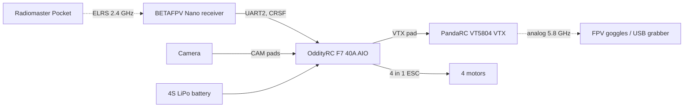
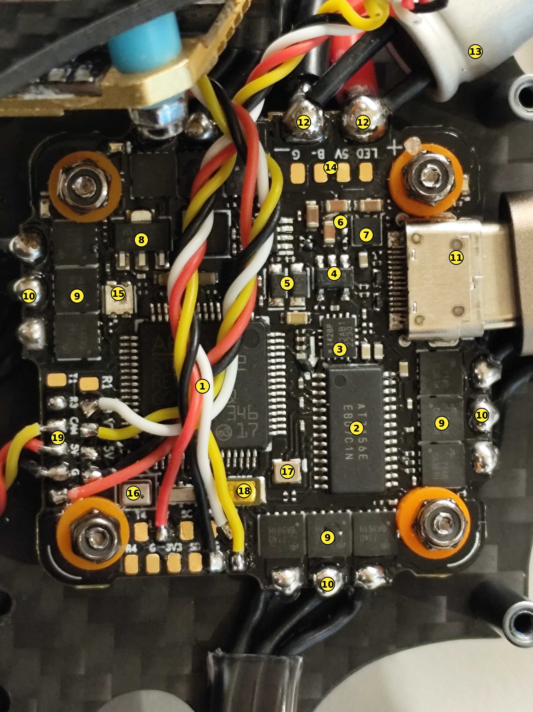
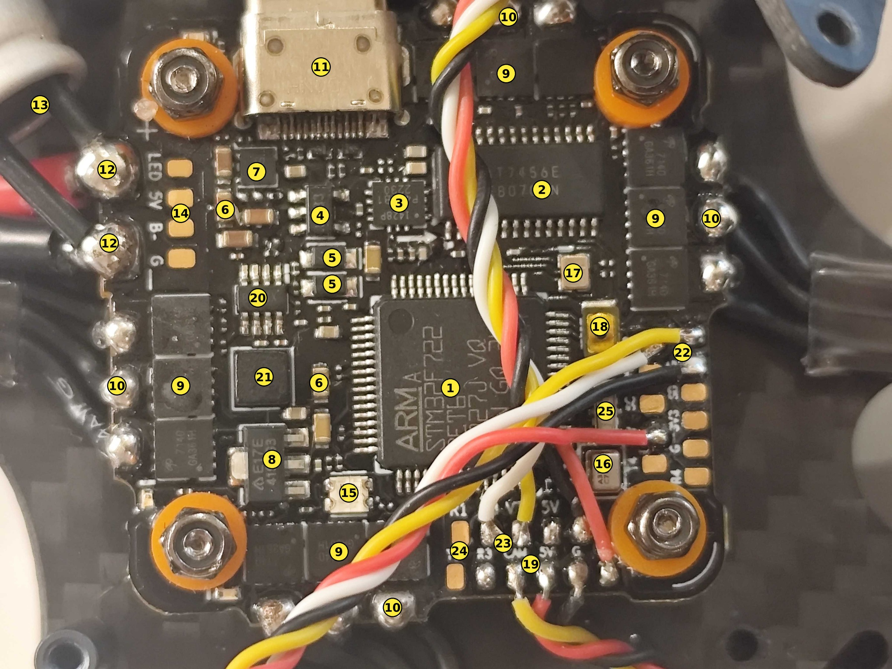
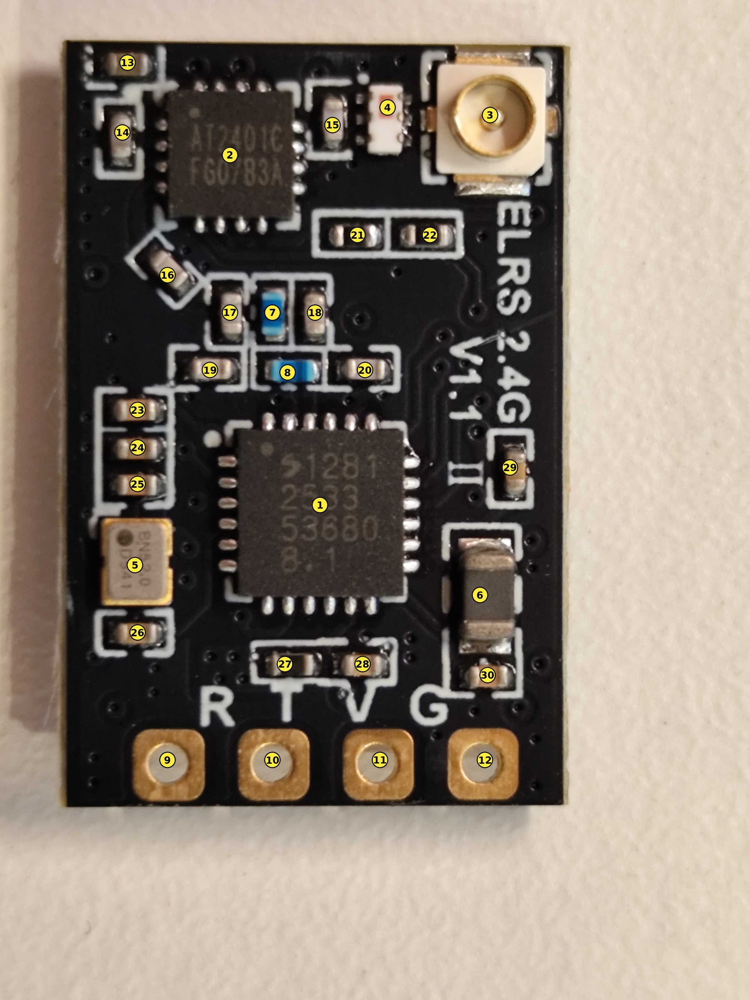
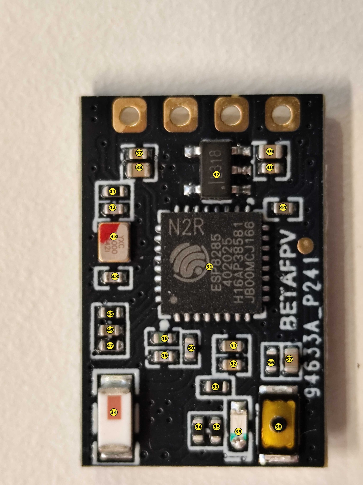
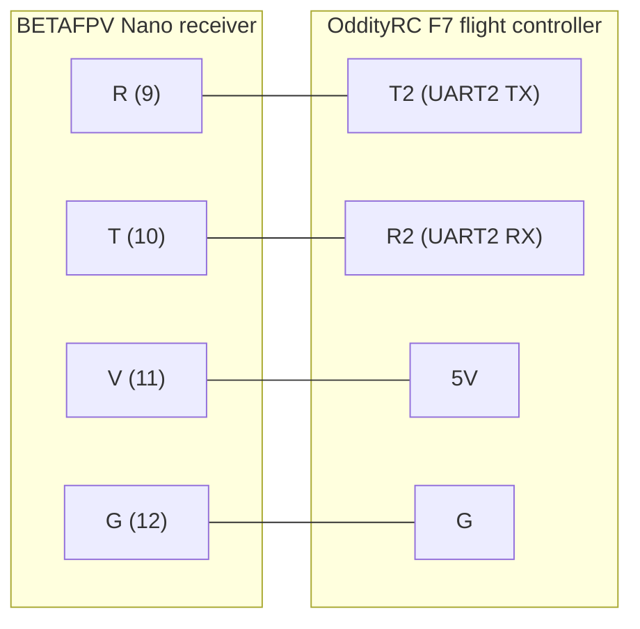
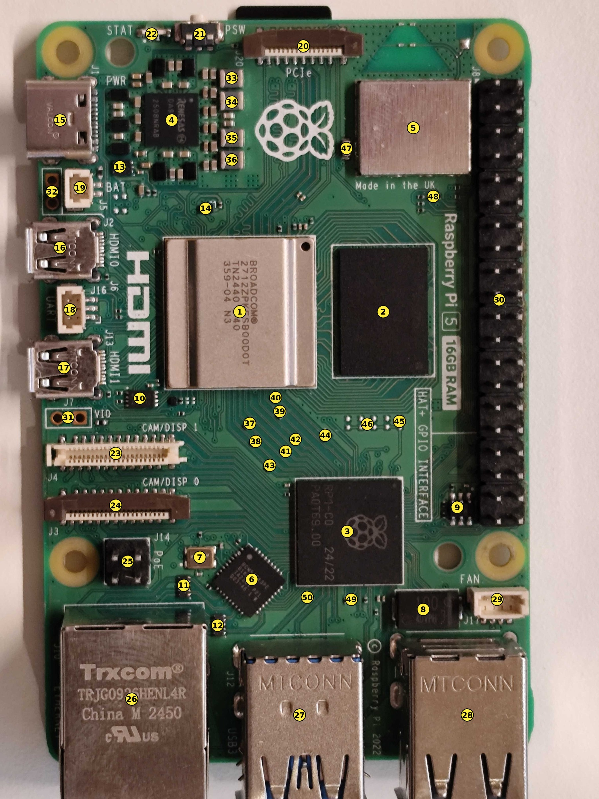
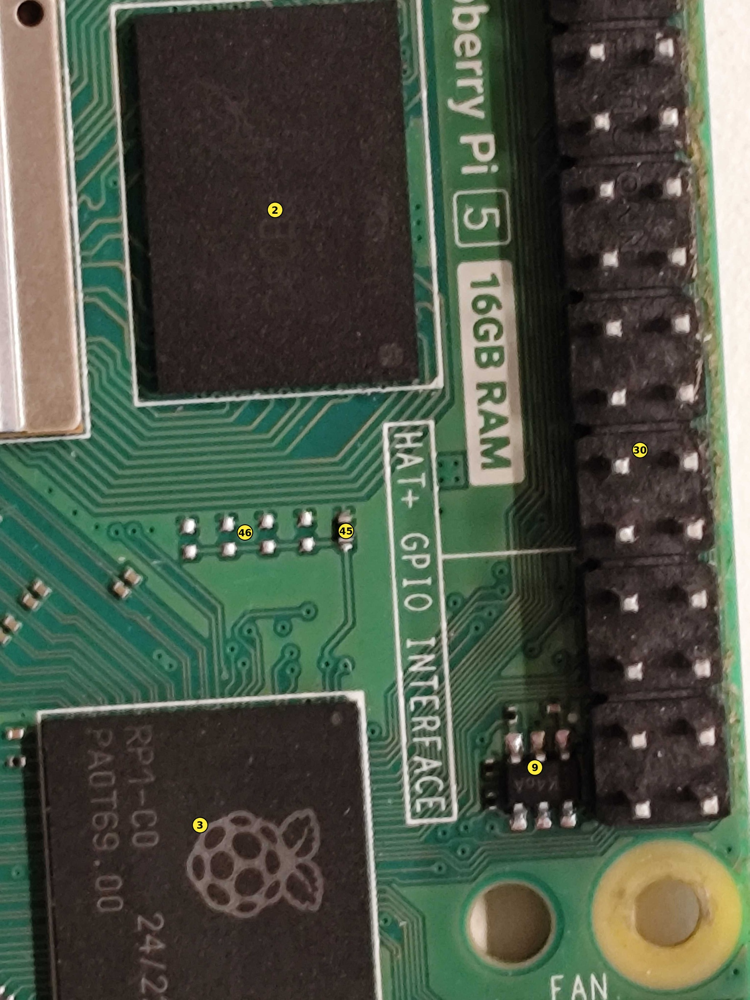
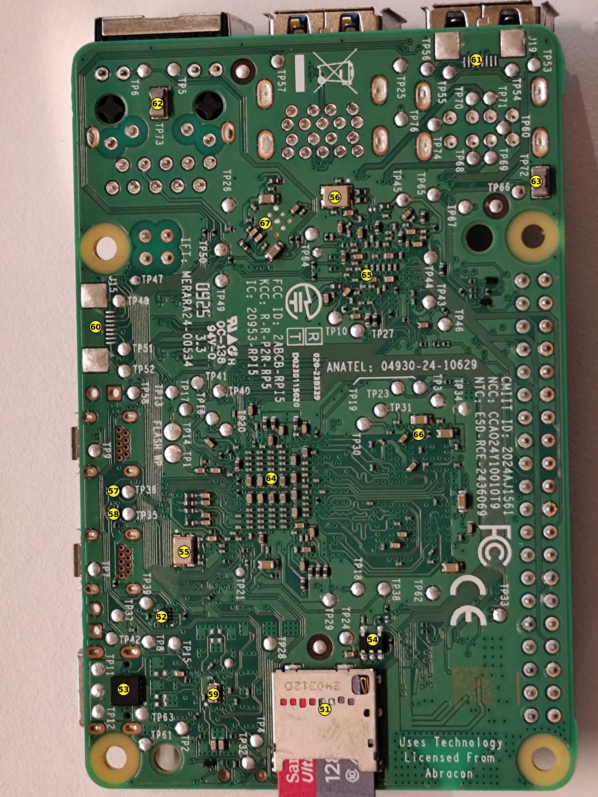

# Hardware: Brook 2.5 FPV drone and Raspberry Pi 5

> [!summary] In one sentence
> This document identifies the **parts of the Pilotix Brook 2.5" drone** (flight controller, ELRS receiver) **and the Raspberry Pi 5**, using photos with numbered parts and the Betaflight console, and says **how sure** each identification is.

> [!info] State 2026-10-20: ELRS and ESP (GitHub #55)
> The ELRS antenna is soldered and the ELRS 5 V wire is on `DV5V` (GitHub #41). **The failsafe has not been tested yet** (GitHub #22 and #41 stay open). An ESP-12F (ESP8266) is soldered to UART4 with removable wires since 2026-10-19 ([[ADR-021 Removable ESP Connector|ADR-021]]).

> [!info] About this document
> The identifications come from **photos and the Betaflight console**, not from measurements or the schematic. Each board has photos with numbered parts and a table that says what each number is.
>
> Portuguese version: [README.md](README.md)

---

## How to read the tables

Every identified part has a **certainty level**:

| Certainty        | Meaning                                                                       |
| ---------------- | ----------------------------------------------------------------------------- |
| ✅ **High**      | Read from the chip marking, from the board silkscreen, or confirmed by Betaflight |
| 🟡 **Likely**    | Deduced from appearance, position and what is usual in this family of boards  |
| 🔵 **Medium**    | Used on a few parts (flight controller 22 and 23, `R2`/`T2` wires). Between *Likely* and *Uncertain* |
| 🟠 **Uncertain** | A guess with little basis                                                     |
| ❓ **Unknown**   | I could not identify it                                                       |

> [!note] Values of small resistors and capacitors
> They **cannot be read from photos**. To get them you need the manufacturer's schematic, or you have to measure each part with a multimeter while it is out of the circuit.

---

## Index

```table-of-contents
style: nestedList
minLevel: 2
maxLevel: 3
includeLinks: true
```

---

## 1. Pilotix Brook 2.5 drone, overview

A 2.5" cinewhoop for a 4S battery, analog, PNP (no receiver included).

### Components

| Component                  | Model                                    | Notes                                                              |
| -------------------------- | ---------------------------------------- | ------------------------------------------------------------------ |
| **Frame**                  | Pilotix Brook 2.5" Cinewhoop             | 4S, analog, PNP                                                    |
| **Flight controller + ESC**| OddityRC F7 40A AIO                      | `manufacturer_id: ODTY`, `board_name: ODDITYRCF7AIO`               |
| **VTX**                    | PandaRC VT5804 BAT LITE                  | 5.8 GHz, up to 1300 mW, 6 to 36 V input, MMCX antenna              |
| **Video receiver on the PC** | MacroSilicon MS210x, USB grabber       | `idVendor=534d`, `idProduct=0021`                                  |
| **Camera**                 | Ratel 2                                  | Analog                                                             |
| **Motors / propellers**    | 1405-4800KV / HQ DT63-3 V2               | From the box specs (SKU 5297)                                      |
| **Antenna**                | Cheery Straight MMCX RHCP                | From the box specs                                                 |
| **Firmware**               | Betaflight 4.5.1, from 17 Oct 2024       | MSP API 1.46                                                       |
| **Radio receiver**         | ELRS 2.4 GHz (BETAFPV Nano)              | See [[#3. ELRS 2.4 GHz receiver (BETAFPV Nano)\|section 3]]        |
| **Transmitter**            | RadioMaster Pocket                       | ELRS 2.4 GHz                                                       |

### System overview



> [!abstract] Basically
> The radio link (**ELRS**) and the video link (**analog 5.8 GHz**) are completely separate. The flight controller sits in the middle and also carries the 4 in 1 ESC.

### Firmware version

Output of the `version` command on the flight controller:

```text
Betaflight / STM32F7X2 (S7X2) 4.5.1 Oct 17 2024 / 19:49:44 (326ecdcf2) MSP API: 1.46
board: manufacturer_id: ODTY, board_name: ODDITYRCF7AIO
```

The factory configuration was saved in `~/drone-backup.txt`, with the output of the `diff all` command.

### Warnings before connecting the battery

> [!danger] Read this before the first power-up
> 1. **Antenna on the VTX** before any battery connection. Without an antenna, the VTX burns out.
> 2. **Propellers removed** for any motor test.
> 3. ~~Never connect the battery and the USB at the same time.~~ Replaced on 2026-10-23 (team decision): battery and USB together are allowed **with props off** ([[Safety Rules]] #16).
> 4. The `BAT` pin on the 6 pin connector is the **direct battery voltage**, not 5 V.
> 5. There is no smoke stopper, so the first battery connection is risky.
> 6. The large capacitor (470 µF, 35 V) has **polarity**. The light stripe on the cylinder must face the black wire, the negative one. This stripe has **not been confirmed yet**.

### 6 pin connector, under the flight controller

This is the **digital VTX connector** (DJI O3, Walksnail, Vista). It is **not used** for the analog VTX, which connects through soldered pads. The order below comes from the manual, from top to bottom in the official diagram.

| Pin   | Function                                       |
| ----- | ---------------------------------------------- |
| `R2`  | UART2 RX, or SBUS coming from the DJI          |
| `GND` | Ground                                         |
| `R6`  | UART6 RX, or TX of the digital VTX             |
| `T6`  | UART6 TX, or RX of the digital VTX             |
| `GND` | Ground                                         |
| `BAT` | Direct battery voltage                         |

> [!note] Not confirmed
> The connector model and the pin pitch are not confirmed.

### To be confirmed

- [ ] A 4S LiPo battery, 650 to 850 mAh, 60C or more, with the same plug as the drone
- [ ] Whether the drone plug is XT30 or XT60 (it is engraved in the plastic)
- [ ] A LiPo charger with 4S balancing and a safety bag
- [ ] Connect the ELRS receiver to the pads and configure it in Betaflight
- [ ] Connect Betaflight Web (app.betaflight.com) in Google Chrome

---

## 2. OddityRC F7 40A AIO flight controller

A flight controller and 4 in 1 ESC on the same board, with 3 pads per motor, a USB-C port, and pads for the camera and the VTX.

### Specifications confirmed by the console (`status`)

| Item                          | Value                                                                    |
| ----------------------------- | ------------------------------------------------------------------------ |
| **Microcontroller**           | STM32F722RET6 at 216 MHz                                                 |
| **Gyroscope and accelerometer** | ICM42688P, about 8 kHz                                                 |
| **OSD**                       | MAX7456 compatible, 30×13                                                |
| **Blackbox**                  | 16 MB of flash (Winbond W25Q128, JEDEC `0x00ef4018`)                     |
| **Temperature**               | 44 °C, no I2C errors                                                     |
| **Battery**                   | Not connected                                                            |
| **Arming flags**              | `RXLOSS`, `CLI`, `MSP`, `DSHOT_TELEM` (normal, with no receiver and with USB) |

> [!note] Barometer
> **DPS310 detected.** `status` on 2026-10-13 and 2026-10-14 shows `I2C:1`, `BARO=DPS310`, `I2C Errors: 0`. The Sensors tab altitude follows the board when it is raised and lowered. The earlier `I2C:0` reading is superseded.

### Photos



*Photo 1, with numbers 1 to 19.*



*Photo 2, with numbers 1 to 25. Numbers 20 to 25 only appear in this photo.*

### Parts table

| No. | What it is                                                                                                              | Certainty        |
| --- | ----------------------------------------------------------------------------------------------------------------------- | ---------------- |
| 1   | **STM32F722RET6** processor. The model can be read in photo 2 and was confirmed by `status`.                            | ✅ High          |
| 2   | OSD chip marked `AT7456E`, compatible with the MAX7456 that Betaflight showed.                                          | ✅ High          |
| 3   | Chip marked `1428P P42AB1 2230`. It looks like the ICM42688P gyroscope, but the marking does not confirm it.            | 🟡 Likely        |
| 4   | 5 pin regulator marked `LG33`. The name suggests 3.3 V.                                                                 | 🟡 Likely        |
| 5   | Two diodes, probably to choose between the 5 V from the USB and the one from the battery.                               | 🟡 Likely        |
| 6   | Large ceramic capacitors, beige in color.                                                                               | 🟡 Likely        |
| 7   | Small integrated circuit, with no legible marking.                                                                      | ❓ Unknown       |
| 8   | Component marked `E17E 419JG3`. It could be a regulator or a MOSFET.                                                   | ❓ Unknown       |
| 9   | Black blocks in groups of 3, the ESC transistors (12 in total). One per group is marked.                                | 🟡 Likely        |
| 10  | Motor pads, 3 per motor, already soldered.                                                                              | ✅ High          |
| 11  | USB-C connector.                                                                                                        | ✅ High          |
| 12  | Battery pads. Red goes to `+` and black goes to `G`.                                                                    | ✅ High          |
| 13  | Electrolytic capacitor of 470 µF and 35 V, from the marking read on the part. The polarity stripe must face the black wire, still to be confirmed. | ✅ High |
| 14  | Four free pads: `G`, `B-`, `5V` and `LED`. By the labels, they are for a buzzer and an LED strip.                       | 🟡 Likely        |
| 15  | Status LED.                                                                                                             | 🟡 Likely        |
| 16  | Component with a hole in it, looks like the barometer.                                                                  | 🟡 Likely        |
| 17  | Beige crystal or oscillator with metal terminals.                                                                       | 🟡 Likely        |
| 18  | Gold pad with a black dot, probably the BOOT button.                                                                    | 🟠 Uncertain     |
| 19  | Camera pads (`CAM`, `5V`, `G`), already soldered. `CAM` is the camera **video input** (vendor diagram, 2026-10-16).     | ✅ High          |
| 20  | 8 pin chip to the left of the processor, maybe the Blackbox flash.                                                      | 🟠 Uncertain     |
| 21  | Square black block, with no marking.                                                                                    | ❓ Unknown       |
| 22  | Pads with 4 wires: `5V`, `G`, `R2` and `T2`. `R2`/`T2` **confirmed with a multimeter** (2026-10-16, GitHub #16). The `5V` wire is now on `DV5V` (GitHub #41, reported 2026-10-20). | ✅ High |
| 23  | Pads with the white and yellow wires, next to `VTX`. They look like SmartAudio and video.                               | 🔵 Medium        |
| 24  | Free pads `R1` and `T1`.                                                                                                | ✅ High          |
| 25  | Elongated silver part, next to the barometer.                                                                           | ❓ Unknown       |

> [!warning] Check before connecting the battery
> Numbers 22 and 23 come from small, partly hidden labels. **Check with a multimeter** before connecting the battery, especially the **red wire**.

### Differences from the shop photos

- The USB on this board is **USB-C**. The shop photo showed micro USB.
- I did not find the `4R7` inductor that appears in the shop photos. This version of the board is different.
- What looked like a button is the gold pad of number 18.

### Pads for the receiver and for the analog VTX

| Group                  | Pads                                                                         |
| ---------------------- | ---------------------------------------------------------------------------- |
| **Receiver (ELRS)**    | UART2: `R2` and `T2`                                                         |
| **Signal pads on the silkscreen** | `T1`, `R1`, `R3`, `T3`, `CAM`, `VTX`, `5V` and `G`                |
| **Motors**             | `M1` to `M4`, with 3 pads each                                               |

---

## 3. ELRS 2.4 GHz receiver (BETAFPV Nano)

By the markings, this is a **BETAFPV ELRS Nano 2.4 GHz**. The front says "ELRS 2.4G V1.1" and the back has "BETAFPV" printed on it.

| Item                    | Value                                  |
| ----------------------- | -------------------------------------- |
| **Radio chip**          | SX1281                                 |
| **Microcontroller**     | ESP8285                                |

### Photos



*Front, with numbers 1 to 30.*



*Back, with numbers 31 to 57.*

### Identified parts, front

| No.    | What it is                                                                                      | Certainty        |
| ------ | ----------------------------------------------------------------------------------------------- | ---------------- |
| 1      | Radio chip. `1281` can be read, with the Semtech logo, so it is the **SX1281**.                 | ✅ High          |
| 2      | Chip marked `AT2401C`, a 2.4 GHz amplifier.                                                     | ✅ High          |
| 3      | Antenna connector, of the U.FL (IPEX) type.                                                     | ✅ High          |
| 4      | LED.                                                                                            | 🟡 Likely        |
| 5      | Crystal marked `BN52.0`, at 52 MHz, which is the frequency the SX1281 uses.                     | 🟡 Likely        |
| 6      | Large inductor, probably for the SX1281 voltage converter.                                      | 🟡 Likely        |
| 7 and 8| Two blue parts, probably radio filters.                                                         | 🟠 Uncertain     |
| 9      | `R` pad                                                                                         | ✅ High          |
| 10     | `T` pad                                                                                         | ✅ High          |
| 11     | `V` pad (power)                                                                                 | ✅ High          |
| 12     | `G` pad (ground)                                                                                | ✅ High          |

### Identified parts, back

| No. | What it is                                                                                              | Certainty        |
| --- | ------------------------------------------------------------------------------------------------------- | ---------------- |
| 31  | `ESP8285` microcontroller. It runs the ELRS firmware and has the Wi-Fi used to update it.               | ✅ High          |
| 32  | Voltage regulator marked `IL318`. It looks like a 3.3 V one, but I could not confirm it.                | 🟡 Likely        |
| 33  | Crystal marked `YXC 26.000` (26 MHz), for the ESP8285.                                                  | ✅ High          |
| 34  | Large status LED.                                                                                       | 🟡 Likely        |
| 35  | Small LED, with a green background.                                                                     | 🟠 Uncertain     |
| 36  | Gold pad with a black dot, probably the BOOT button.                                                    | 🟡 Likely        |

### Resistors and capacitors

The small parts have no marking. They are grouped by appearance, with no values.

| Appearance                    | Likely function                    | Numbers                                                                                          |
| ----------------------------- | ---------------------------------- | ------------------------------------------------------------------------------------------------ |
| Beige body, metal terminals   | Ceramic capacitor                  | 13, 16, 18, 23, 24, 25, 26, 28, 29, 30 (front) and 37, 38, 39, 40, 44, 46, 49, 51, 52, 57 (back) |
| Light gray                    | Capacitor, probably for radio      | 14, 15, 17, 19, 20 (front) and 43, 50 (back)                                                     |
| Dark body                     | Resistor                           | 21, 22, 27 (front) and 41, 42, 45, 47, 53, 54, 55, 56 (back)                                     |
| Dark, with a green mark       | Resistor or diode                  | 48                                                                                               |

### Connection to the drone

The pads are the same on both faces, only seen from opposite sides. On the back the order is reversed.

| Receiver pad | Connects to                                | Notes                                                                          |
| ------------ | ------------------------------------------ | ------------------------------------------------------------------------------ |
| `R` (9)      | `T2` on the flight controller (UART2 TX)   | The RX of one connects to the TX of the other                                  |
| `T` (10)     | `R2` on the flight controller (UART2 RX)   | The TX of one connects to the RX of the other                                  |
| `V` (11)     | `DV5V` (moved from `5V`, GitHub #41, reported 2026-10-20) | The vendor diagram powers the receiver from `DV5V`                             |
| `G` (12)     | `G`                                        | Ground                                                                         |



> [!tip] Betaflight setup
> On the **Ports** tab, enable **Serial Receiver** on **UART2** and choose **CRSF** as the protocol.

> [!danger] Antenna first
> The antenna must be connected to the U.FL (3) **before** connecting the battery.

---

## 4. Raspberry Pi 5 with 16 GB

A board **without a heatsink or a fan**, with a SanDisk Ultra 128 GB microSD card inserted.

| Marking on the board silkscreen | Value             |
| ------------------------------- | ----------------- |
| **FCC ID**                      | `2ABCB-RPI5`      |
| **IC**                          | `20953-RPI5`      |
| **ANATEL**                      | `04930-24-10629`  |

### Photos



*Top face, with numbers 1 to 50.*



*Close up with the same numbers as the top face: 2, 3, 9, 30, 45 and 46.*



*Bottom face, with numbers 51 to 67.*

### Chips, top face

| No.                  | What it is                                                                                                              | Certainty        |
| -------------------- | ----------------------------------------------------------------------------------------------------------------------- | ---------------- |
| 1                    | Broadcom **BCM2712** SoC. `BROADCOM 2712ZPKFSB00D0T` can be read.                                                       | ✅ High          |
| 2                    | 16 GB memory. The chip has no legible marking, but the board has "16GB RAM" printed on it.                              | 🟡 Likely        |
| 3                    | `RP1-C0`, the chip that handles the USB, Ethernet, GPIO and cameras.                                                    | ✅ High          |
| 4                    | Renesas `DA9091` power manager.                                                                                         | ✅ High          |
| 5                    | Module with a metal shield, probably the Wi-Fi and Bluetooth.                                                           | 🟡 Likely        |
| 6                    | Broadcom chip `BCM5421…`, probably the Ethernet.                                                                        | 🟡 Likely        |
| 7                    | Oscillator marked `AEL25.00`, at 25 MHz.                                                                                | 🟡 Likely        |
| 8                    | Large diode, marked `100`.                                                                                              | 🟡 Likely        |
| 9, 10, 11, 12, 13, 14| Small chips and a transistor, with no marking I can read. Number 9 seems to have `K40A`, but I did not confirm it.      | ❓ Unknown       |

### Connectors and buttons, top face

> [!success] High certainty
> These connectors have high certainty, because their function is **printed on the board itself**.

| No.      | What it is                                                         |
| -------- | ------------------------------------------------------------------ |
| 15       | USB-C power input (`J1`, `PWR`)                                    |
| 16 and 17| Micro HDMI 0 (`J2`) and 1 (`J13`)                                  |
| 18       | Debug UART (`J16`)                                                 |
| 19       | Clock battery (`J5`, `BAT`)                                        |
| 20       | PCIe (`J20`)                                                       |
| 21       | Power button (`PSW`)                                               |
| 22       | Status LED (`STAT`)                                                |
| 23 and 24| Camera or display 1 (`J4`) and 0 (`J3`)                            |
| 25       | PoE header (`J14`)                                                 |
| 26       | Trxcom `TRJG0926HENL4R` RJ45, with the transformers inside         |
| 27       | Two USB 3 ports (`J12`, `USB3`)                                    |
| 28       | The other two USB ports, probably USB 2                            |
| 29       | Fan (`J17`, `FAN`)                                                 |
| 30       | 40 pin GPIO header (`J8`)                                          |
| 31 and 32| Plated holes next to `VID` and `BAT`. I do not know what they are for. |

### Small parts, top face

| No.            | Description                                                                                     |
| -------------- | ----------------------------------------------------------------------------------------------- |
| **33 to 36**   | Gray blocks next to the power manager, probably inductors                                       |
| **37 to 44**   | Small parts in the middle of the board, between the SoC and the RP1. They are resistors or capacitors, with no marking |
| **45**         | Black part with a metal end, in the close up                                                    |
| **46**         | Eight pads with no component, in the close up. You can see that nothing is mounted there        |
| **47, 48, 50** | Beige parts, probably capacitors                                                                |
| **49**         | One of several small parts in a row, next to the RP1                                            |

### Bottom face

| No.              | What it is                                                                                   | Certainty        |
| ---------------- | -------------------------------------------------------------------------------------------- | ---------------- |
| 51               | microSD slot, with a SanDisk Ultra 128 GB card                                               | ✅ High          |
| 52, 53, 54       | Small chips: one with 8 pins, one square, another with 6 pins next to the microSD slot       | ❓ Unknown       |
| 55 and 56        | Oscillators or crystals                                                                      | 🟡 Likely        |
| 57 and 58        | Small black parts next to `TP36` and `TP35`                                                  | ❓ Unknown       |
| 59               | Beige part, probably a capacitor                                                             | 🟡 Likely        |
| 60 and 61        | Contact strips next to `J15` and `J19`                                                       | ❓ Unknown       |
| 62 and 63        | Gray parts, possibly inductors or fuses                                                      | 🟠 Uncertain     |
| 64, 65, 66, 67   | Groups of small capacitors and resistors                                                     | 🟡 Likely        |

> [!note] Test points
> For 64 to 66 I am not sure which chip on the top face sits above each group. The points `TP1` to `TP76` are test points and have their numbering printed on the board, so they were not numbered.

### What was left unnumbered

Only some of the small parts around the power manager (4) are marked, not all of them. On the bottom face, the swarm of capacitors and resistors is in groups. To number each one, **close up photos in quadrants** are needed.

---

## 5. Manual, ELRS and radio notes

### Box specs and the manual

**Pilotix Brook 2.5" Cinewhoop 4S Analog PNP** (SKU 5297). The box lists: Ratel 2 camera, 5.8 GHz 1.3 W VTX, 1405-4800KV motors, F7 40A AIO, Cheery Straight MMCX RHCP antenna, HQ DT63-3 V2 propellers, **no receiver**.

> [!warning] Manual is for a different model
> The manual covers the **Spark 2" Cinewhoop** (SKU 5273), not our Brook 2.5" (SKU 5297). Several specs differ (it lists an F411 20A flight controller, 1204-3500KV motors, a 400 mW VTX and about 82 g), so trust the box specs and the console output above where they conflict.

- Manual (in Czech): [Spark 2inch Cinewhoop 4S Analog PNP manual](https://public.hobbydrone.cz/Pilotix/5273/Manual/5273%20FPV%20drone%20Spark%202inch%20Cinewhoop%204S%20Analog%20PNP%20CS.pdf)
- PNP means we choose the antenna placement and connector type, whereas BNF versions have these fixed.
- The manual recommends soldering the receiver directly to the pads (**GND, 5V, RX, TX**) for a more robust connection.
- Pilotix support: WhatsApp +420 777 054 888, support@pilotix.eu, Telegram [PilotixSupport_bot](https://t.me/PilotixSupport_bot).

### What is required to fly

- [ ] Solder and soldering iron
- [ ] 4S LiPo battery, 450-650 mAh per the manual (see [[#To be confirmed]])
- [ ] FPV goggles (we apparently have a connector for a screen)
- [x] Own receiver: BETAFPV Nano, see [[#3. ELRS 2.4 GHz receiver (BETAFPV Nano)|section 3]]
- [x] Transmitter: RadioMaster Pocket

### ELRS (ExpressLRS)

Open source radio-control system: very low latency, long range, cheap, common in modern FPV. It works at 2.4 GHz or 868/912 MHz and needs an ELRS transmitter **and** an ELRS receiver.

- [ELRS GitHub: OpenTX and Betaflight Setup](https://github.com/ExpressLRS/ExpressLRS/wiki/OpenTX-and-Betaflight-Setup)
- [ELRS Quick Start](https://www.expresslrs.org/quick-start/getting-started/)

### BETAFPV Nano receiver: spec and LED status

| Spec            | Value      |
| --------------- | ---------- |
| Weight          | 0.7 g      |
| Input voltage   | 5 V        |
| Telemetry power | 20 dBm     |
| Size            | 12 × 19 mm |

| LED behavior         | Meaning                |
| -------------------- | ---------------------- |
| Solid on             | Connected successfully |
| Flashes double, fast | Binding status         |
| Flashes slowly       | Connection failed      |
| Flashes quickly      | WiFi upgrade status    |

### Software setup on the laptop

- [x] Installed ExpressLRS firmware
- [x] Installed udev rules for ELRS

```bash
curl -fsSL https://raw.githubusercontent.com/platformio/platformio-core/master/platformio/assets/system/99-platformio-udev.rules | sudo tee /etc/udev/rules.d/99-platformio-udev.rules
sudo service udev restart
sudo usermod -a -G dialout $USER
sudo usermod -a -G plugdev $USER
```

---

## Limits of this document

> [!warning] Read the identifications with care
> - The identifications come from **photos**, not from measurements or from the schematic. The chip markings were read by eye and may have errors in the smallest letters.
> - The numbers in the images are **not** those of any official schematic. They only link each photo to its table.
> - Each board has its own numbering. Number 1 on the flight controller is not number 1 on the receiver.

---

> [!abstract] Basically
> **Flight controller + 4 in 1 ESC** (OddityRC F7 40A), **ELRS receiver** wired to **UART2** (CRSF), **analog 5.8 GHz VTX**, and a **Raspberry Pi 5** with 16 GB. Always check the certainty column, and always put the antenna on before the battery.

---

## Glossary

| Term             | Meaning                                                                                 |
| ---------------- | --------------------------------------------------------------------------------------- |
| **AIO**          | All in one: flight controller and ESC on the same board                                 |
| **ESC**          | Electronic speed controller, drives the motors                                          |
| **ELRS**         | ExpressLRS, open source radio control link                                              |
| **CRSF**         | Serial protocol used between the ELRS receiver and the flight controller                |
| **UART**         | A serial port (`R` = receive, `T` = transmit)                                           |
| **VTX**          | Video transmitter                                                                       |
| **OSD**          | On screen display, text and data drawn over the video                                   |
| **PNP**          | Plug and play: no receiver included                                                     |
| **Blackbox**     | Flight log stored in flash memory                                                       |
| **SoC**          | System on chip (the main processor of the Raspberry Pi)                                 |
| **TP**           | Test point on a circuit board                                                           |
| **API** | Application Programming Interface: a defined way for software components to communicate. |
| **FC** | Flight Controller: on this project the OddityRC F7 AIO (STM32F722, Betaflight target `ODDITYRCF7AIO`) of the 2.5" drone. It stabilises the aircraft and takes MSP from the ESP on UART4. |
| **MSP** | MultiWii Serial Protocol, used for communication with Betaflight flight controllers. |
| **Mermaid** | A text-based diagram syntax rendered by compatible Markdown tools. |
| **LiPo** | Lithium-polymer battery: the 4S flight pack. Handle it by the rules in Safety Rules. |
| **GPIO** | General-purpose input/output: a configurable pin on a microcontroller. |
| **XT60** | The battery connector on the pack. An XT30 to XT60 adapter is used on the drone. |
| **mAh** | Milliamp-hour: battery capacity. |
| **USB** | Universal Serial Bus: used to flash the ESP and to power or configure the FC from a PC. |
